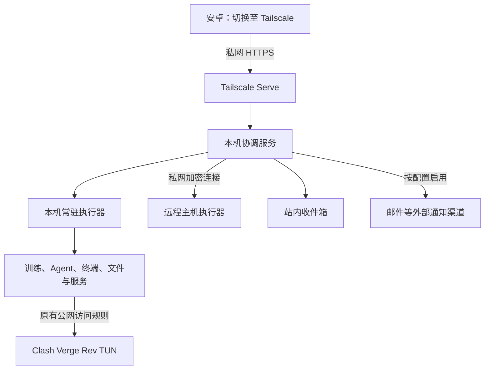

# 安卓个人远程工作站：最终总体方案

版本：1.0｜日期：2026-10-23｜交付状态：方案定稿，产品尚未实施与部署。

## 1. 总体决定

目标是在安卓上完整管理自己的电脑与远程算力：下达工作、查看过程、补充指令、处理问题、检查成果。电脑持续执行，手机作为移动入口。

| 事项 | 最终决定 |
|---|---|
| 产品组织 | 以项目串联材料、代码、环境、agent、实验与成果；以任务记录实际工作和每次执行 |
| 主导航 | 总览 / 项目 / 任务 / 设备，共四项；取消独立工作台 |
| 部署 | 用户自己的 Windows 电脑运行协调服务与常驻执行器，可接远程 Linux、GPU 主机和 WSL |
| 远程访问 | Tailscale 私网 + Tailscale Serve HTTPS；默认不购买公网节点和域名 |
| 电脑代理 | Clash Verge Rev 的 TUN 始终保留，使用持久路由排除与 DNS 分流实现共存 |
| 安卓操作 | 访问时切换原 VPN 至 Tailscale；切回原 VPN 后任务继续，面板暂时不可达 |
| 通知 | 站内持久收件箱；外网提醒接可配置邮件渠道；私网即时通知可接 ntfy |
| 既有工具 | 复用可用的 CLI、API、编辑器、训练环境和服务，通过统一上下文与适配器连接 |
| 设计参考 | 同学截图用于理解能力与场景，布局、配色、导航、端口与工具选择可重新设计 |
| 交付方式 | 一次定义完整范围，按依赖施工，按整套场景验收 |

当前明确的是安卓、Windows 和 Clash Verge Rev TUN。截图中的 3090、主机名、IP 和端口不代表用户自己的设备。具体 GPU、agent、目录与既有服务在实施准备时形成一次实际接入清单。

## 2. 产品结构：四个入口，共用一套工作记录

| 页面 | 负责的事情 | 具体操作与边界 |
|---|---|---|
| 总览 | 快速掌握现在的工作，处理需要人的事项 | 待回复、失败、运行摘要、最近成果与继续工作；进入同一任务详情 |
| 项目 | 组织工作材料和上下文，发起工作 | 文件、代码、运行环境、agent 会话、实验配置、关联服务、项目成果与历史 |
| 任务 | 跨项目管理实际执行 | 运行、排队、等待回复、历史、工作流；日志、停止、重跑、复制配置、尝试链 |
| 设备 | 管理机器及其运行资源 | 主机、GPU、进程、磁盘、环境、服务、容器、连接与设备终端 |

项目中的任务列表是按项目筛选的同一份记录。设备资源页可以定位到同一任务。首页里的回复、停止与查看结果使用同一操作接口，不另建数据副本或详情页。

### 入口归属

- Agent 对话、项目终端、文件和编辑器归项目；全局最近使用与收藏提供快捷入口。
- 服务由设备管理，可关联一个或多个项目；项目里展示其用途、状态与访问入口。
- 全局新建支持临时命令、终端、agent 会话和文件操作，不强制先建立项目；之后可关联项目。
- 临时工作仍明确环境与目录；附件放进该任务的受管目录。归入已有或新建项目时保留任务、执行、会话与成果标识，原链接和历史继续可用，不重新执行或复制记录。
- 通知、搜索、收藏和新建属于全局工具，不再各占一个底部主导航。
- 从任务打开文件、终端、agent 或编辑器时，保留设备、环境、项目与任务上下文；工具不支持深链时给出实际可用的交接方式。

### 安卓体验

首页优先显示待处理与正在运行的工作；内部端口等放进设备或服务详情。主要页面适配竖屏、软键盘、触摸与返回手势；终端提供 Ctrl、Esc、Tab、方向键和常用命令。日志支持跟随末尾、暂停滚动、搜索与复制，用户翻阅历史时不被新输出强行拉走。

完整代码编辑器和第三方应用可独立打开；可用时嵌入，保留返回项目的入口。桌面宽屏使用同一套数据，提供更充分的并排工作区域。

## 3. 统一对象与关联

| 对象 | 定义与关系 |
|---|---|
| 设备 Device | 实际电脑或远程主机，管理网络身份与硬件资源 |
| 环境 Environment | 设备上的执行位置与依赖，如 Windows、某个 WSL 发行版、Conda/venv 或容器；记录路径和启动方式 |
| 项目 Project | 绑定工作目录、仓库、环境、模板、会话、服务和成果；可有多个设备位置 |
| 任务 Task | 可持续追踪的工作目标；可以临时存在，也可以归属项目 |
| 执行 Run | 任务的一次实际尝试；记录设备、环境、参数、版本、状态、日志与输出；重跑保留旧记录并创建新尝试 |
| 会话 Session | 持久终端或 agent 对话；可关联多个任务，普通按键输入不自动产生一堆任务 |
| 成果 Artifact | 图片、报告、网页、模型、数据等，记录来源执行、版本信息和实际位置 |
| 服务 Service | 持续提供能力的应用，记录所属设备、环境、访问入口、日志与运行管理方式 |
| 工作流 Workflow | 由多个步骤和明确条件组成；每个步骤关联实际任务与执行 |
| 事件 Event | 状态变化、消息、回复请求和成果产生等；驱动实时界面、通知与历史 |

任务描述工作目标，Run 描述一次执行事实；两者分别存状态。普通单步任务可按约定随成功执行结束，多步骤目标按交付条件汇总，不因某条测试命令退出为零就宣称整个目标完成；不统一增加人工验收门槛。

Windows 与 WSL 是同一物理设备的不同执行环境；同一张 GPU 按硬件身份关联，避免重复统计或错误计算可用资源。远程路径和本机路径保持明确，不把相同目录名视为同一份文件。

常驻服务与一次执行分别管理。服务启动或重启操作可以留下执行记录，但不能把一个长期在线的服务当成永不结束的训练任务。

## 4. 完整功能范围

### 4.1 项目、代码与环境

- 绑定已有目录，建立项目，管理环境和启动模板；保留原有项目的运行方式。
- 展示 Git 分支、改动、diff 和启动时的版本；未提交修改也记录状态，不擅自提交或清理。
- 文件、日志、错误与选中代码可直接交给 agent；输出回到原项目。
- 原生 Windows、WSL 和远程环境分别记录工作目录、解释器/可执行文件、参数、环境变量与输出位置。
- 通过明确启动配置调用 Conda、venv 或容器，不依赖某次桌面终端恰好激活的环境。
- 同一文件被手机与桌面同时修改时呈现版本差异并提供合并选择；并行编码任务可使用独立 Git worktree，普通训练和只读任务不因此锁住整个项目。
- 文件变化检测覆盖外部编辑器；保存冲突保留手机草稿，允许对比、合并或另存。项目、任务与会话可归档并恢复，保留搜索和关联；归档不自动停止服务或删除文件。

### 4.2 Agent

- 发起与继续实际接入的 agent 会话，附加文件、日志、diff 和任务目标。
- 查看消息、执行过程、工具输出、修改文件和成果；支持的回复、中止、审批与恢复均落到真实接口。
- 按项目保存执行偏好，减少重复操作，保留工具原有权限语义。
- 手机与桌面的消息按服务端确认顺序同步；发送中、已接收与等待核实可区分，重连不重复提交。交接文件和日志时显示目标环境实际可读的附件位置、选中范围与来源，不把本机路径冒充远程可读路径。
- 接入分为结构化 API、交互式 CLI、外部 Web 三种方式；交付一张真实能力矩阵：会话创建、继续、输入、事件、取消、审批、成果和历史导入。
- CLI 无结构化事件时提供真实终端和输出，不伪造工具步骤或完成状态。
- 既有桌面聊天或历史会话只有在工具支持时导入与继续；能读历史和能接管运行分别标明。
- 界面展示实际报告的 token/调用用量；费用估算需要提供者与价格依据，缺数据时显示未知。统计不默认变成自动停工额度。

### 4.3 训练与实验

- 训练、评估、预测和数据处理统一启动；保存、复制和比较配置，支持批量实验和显式队列。
- 记录解释器、命令、工作目录、代码状态、数据引用、日志、指标、checkpoint 与输出。
- 区分提交配置与实际启动状态：普通任务默认在启动时使用所选目录的当前内容，并记录实际配置和代码状态；需要复现实验时可固定配置、代码与输入快照，不默认复制整套大数据。
- 重跑新建尝试，复用明确参数，并展示采用原快照还是当前工作区；复制配置后运行可以先编辑。排队期间文件变化可追溯，旧尝试保留。
- 从既有指标文件、TensorBoard 或明确的日志适配提取指标；无法识别时展示原始日志和真实运行状态，不伪造百分比或剩余时间。
- GPU 资源关联具体进程与任务；并发按用户设置，不因未经验证的显存估计强制禁止启动。
- 具备 checkpoint 机制的脚本提供保存点恢复；普通程序提供停止、重跑。暂停和继续按实际机制提供。
- 对比指标、参数与预测样例；保留训练集/验证集等标签，不凭名称推断指标优劣方向。
- TensorBoard 等成熟可视化工具可直接接入，摘要与完整工具使用同一实验来源。

### 4.4 终端、文件与成果

- 提供 Windows、WSL 和远程 shell，保持电脑端会话；手机断线后可重新连接仍存活的会话。
- 多端可查看同一终端输出；输入时展示当前控制端，并支持直接接管，避免两端按键混写，不因此锁住其他文件和任务。
- 文件浏览、上传下载、创建目录、文本与配置编辑、图片/PDF/媒体预览和结果下载。
- 手机到电脑的上传采用分块和断点恢复；关闭页面或切走私网可能暂停，返回后续传。需要重新选择源文件时明确提示。
- 电脑到电脑的复制、下载、压缩等由后台执行，离开页面后继续，长操作记为任务。
- 成果可查看来源、日志、配置与实际文件位置；网页成果有私网预览入口，任意模型文件不承诺通用浏览器预览。
- 成果有独立标识、名称、生成时间、来源尝试、类型与可用性，可代表文件或目录。输出由模板、adapter 或手动收录明确登记，不把任意新文件都猜成最终成果。
- 报告、图片与关键小文件可保存版本；大模型与数据保留位置引用及必要校验信息，按用户选择归档。原文件移动或丢失时保留成果记录并支持重新定位；同名输出覆盖不能悄悄改写旧成果身份。
- 网页成果区分静态文件与依赖运行服务的预览入口，分别显示实际可用状态。
- 大目录分页加载，搜索限定明确范围；避免首次使用就扫描全部磁盘。
- 移除项目关联、清理历史记录、删除实际文件是独立操作，保留用户原有文件。

### 4.5 设备、服务与已有工作

- 展示设备在线与最后观测时间，读取实际可得的 CPU、内存、磁盘、网络、GPU 与温度。
- 查看进程和资源来源；对控制台外启动的程序可发现并关联项目，状态来自实际观测。
- 已运行程序的接入分为：仅观察、读取已有日志/指标、经验证可管理。不能仅凭发现进程就宣称能接管终端或恢复输入。
- 注册已有服务、文件工具、代码环境、Notebook、API、推理服务与网页；按配置生成入口。
- 提供实际受管服务的启动、停止、重启、日志与探活；未接入管理方式的服务明确标为仅访问/观察。
- 容器存在时管理容器；直接运行的 Python、Conda、venv 和 WSL 同样可用，无需迁移既有环境。
- 代码环境使用适用平台的现成方案；例如 code-server 在已验证的 Linux/WSL 环境接入，不默认把其 Linux 安装流程用于原生 Windows。
- 通用服务和命令模板通过配置新增；新协议或新运行时需要 adapter，不承诺所有工具零代码接入。

### 4.6 工作流与调度

- 模板示例：数据整理→训练→评估→报告→通知；agent 修改→测试→网页预览→通知。
- 每一步保存实际输入、输出和执行，支持从失败步骤重跑；已完成步骤是否重跑由工作流定义。
- 下游引用具体上游尝试的成果；上游重跑后，受影响的下游按新输入重新生成并保留旧历史，避免新模型配旧评估报告。
- 停止当前执行、取消排队项、停止本次工作流后续步骤分别定义，不误停同项目的独立任务或服务。
- 定时、手动、上一步完成与资源队列触发；显示时区和预计触发时间。错过的定时执行按模板策略处理并记录。
- 网络重传只恢复同一请求；业务失败重试由步骤声明，避免把有副作用的任务重复执行。
- 自然语言可生成结构化工作配置，配置可见可编辑；执行器按确定配置运行。
- 常用准备检查作为可选步骤，不把所有任务强制套入统一预检流程。

## 5. 网络与信道定案

### Tailscale 与 Clash Verge Rev 共存

1. Tailscale 只负责设备互联，电脑不选择出口节点；Clash 保留原有公网代理策略。
2. 根据实际路由，对 Tailscale 地址范围 `100.64.0.0/10`、`fd7a:115c:a1e0::/48` 及实际启用的相关路由做 TUN 排除，避免泛化排除所有内网。
3. 实际使用的 Tailscale 域名由适当的私网 DNS 解析，避免 Fake-IP 或全局 DNS 改写导致错误路由；保留原有普通域名解析策略。
4. 分别检查内层私网访问与 Tailscale 自身外层连接，按真实可达性配置，避免回环或不支持的 UDP 路径。
5. 配置落在 Clash Verge Rev 的 Merge/Script 持久增强中，结合实际客户端版本和最终生效配置验证，避免订阅更新覆盖。
6. Tailscale Serve 反向代理本机控制台并提供自动证书的私网 HTTPS；不启用公网 Funnel 作为默认入口。

这是一项依据官方机制做出的选型。尚未在用户实际网络上完成穿透、速度和重连实测；不保证 Tailscale 在所有网络都比 ZeroTier 更快。ZeroTier 保留为备选，切换接入方式不改变项目与任务数据。

### 四种逻辑通道

| 通道 | 实现与行为 |
|---|---|
| 指令 | HTTPS API，带唯一请求标识，返回接收结果、任务编号和实际状态 |
| 实时交互 | WSS，按任务/会话分流；从已确认的事件与日志位置恢复 |
| 文件 | 独立 HTTPS 数据传输，分块、进度、续传与可配置并发，避免大文件持续挤占交互 |
| 通知 | 由持久事件投递至收件箱及已启用的外部渠道，不依赖实时连接常开 |

单一私网入口提供统一登录与访问。第三方服务需要时保留独立私网地址；不假定所有应用都能改为同域子路径。

### 费用与访问边界

- 当前 Tailscale 个人非商业免费方案覆盖手机与个人电脑的接入，默认无新增 VPS 和域名订阅。具体方案政策以实施时官方页面为准。
- 现有宽带、手机流量、电费及模型 API 费用独立存在；控制台不把模型调用费算成网络免费。
- 手机切回原 VPN 后，私网面板和私网 ntfy 会暂时不可达；重新切回后补取状态与历史。
- 主控电脑休眠、断电或关机时，无法访问其控制台；远程机器上仍存活的任务继续运行。当前不引入付费常开中枢或多主控自动切换。

## 6. 通知的完整行为

**默认数据来源是持久收件箱。** 完成、失败、等待回复、服务变化和传输结果写成事件；实时页面和外部通知引用同一事件，重复投递可合并。

- 私网连接开启时：页面实时更新；可配置私网 ntfy 安卓客户端接收即时通知。
- 启用邮件后：关键事件按订阅独立投递，不依赖判断手机当前开的是哪种 VPN；复用现有邮箱，不要求另租通知服务器。手机切回原 VPN 后仍可通过邮箱接收。邮箱服务与安卓客户端的送达行为需要实测。
- 未配置外部通知时：所有事件留在收件箱，返回私网后可见；界面明确当前通知渠道是否可达，不承诺离线即时推送。
- 外部消息包含必要摘要和私网深链；打开详情仍需连接 Tailscale。敏感日志、密钥和完整文件不自动发到外部渠道。
- 投递失败单独记录并按渠道策略重试，不把原任务改为失败。
- 邮件服务接受消息与手机实际收到分开记录，不能仅凭发送接口成功就宣称锁屏通知已到达。
- 主控电脑离线时不能由它自己发出即时离线通知；如有独立在线节点才可提供外部心跳监测。

## 7. 执行与会话的持续运行

### 进程职责

协调服务保存项目、任务、索引、工作流与配置；常驻执行器维护实际进程、终端、文件和主机指标。两者接口分开，单机部署一起安装。

长任务及 PTY 会话由独立于网页/API 服务的任务宿主持有。关闭浏览器、网络断线和协调服务更新不会主动结束它们。执行器或任务宿主自身崩溃、主机重启属于另一种故障：重新核对进程与记录；能恢复的按真实机制恢复，已消失的终端需要新会话。

### Windows 部署身份

执行器使用实际工作账户，并显式保存启动环境；安装时确定登录启动或指定账户开机运行。不能默认用 LocalSystem 后假定可访问当前用户的 API 凭据、SSH 密钥、配置和 Python 环境。锁屏继续运行，注销及未登录运行行为纳入实际验证。

任务运行期间可按设置保持系统唤醒，屏幕可关闭；任务结束释放临时唤醒请求。睡眠、关机和系统更新的实际影响可见。远程唤醒仅在硬件与网络条件满足时提供，不能作为默认可用能力。

### 状态与操作

- 执行状态区分排队、启动中、运行、等待回复、停止中、成功、失败、已取消和待核实；任务页聚合这些事实与目标进展。
- 设备连通、服务可达、进程存活和工作完成分别记录，并显示最后观测时间。
- 停止返回真实状态；温和结束与强制结束按程序能力提供，不把按钮点击当成停止完成。
- 进程身份包含启动信息等实际核验依据，避免 PID 重用造成误控制。
- 日志长时间不更新不自动判死，不因短时指标波动锁停任务。
- 手机离线可看带时间的缓存与保存草稿；操作需得到实际接收结果，不把断线期间的旧命令悄悄积压成之后执行的操作。
- 描述、配置、消息和编辑草稿可恢复；提交瞬间断线时按请求标识查询是否已接收，显示正在核实或待提交，再决定重试。

## 8. 技术实现与运维

| 部分 | 实现选择 |
|---|---|
| 前端 | React + TypeScript，移动端优先、PWA、响应式桌面布局 |
| 协调服务/执行器 | Node.js + TypeScript，共享对象与事件协议 |
| 交互终端 | node-pty 与成熟终端前端；各平台启动方式独立适配 |
| 结构化状态 | SQLite；设备端保存执行事实，主控保存聚合与工作关系 |
| 大量内容 | 日志、附件、指标和成果保留文件，数据库保存索引与来源 |
| 接入 | 标准 adapter：主机、环境、agent、指标、服务与通知 |

既有训练依赖保持在原 Python/Conda/venv 环境。node-pty 的安装依赖与实际 shell 在目标 Windows 验证；WSL、Linux 和容器按实际启用范围适配。

### 安装、升级和恢复

- 提供统一安装/启动/停止方式、设备接入说明和连接诊断；自动启动与后台账户一次配置。
- 单用户应用登录与本人授权的私网设备访问；凭据放在服务端或系统凭据存储，前端不保存模型密钥。
- 升级前生成一致的数据库和配置备份；协调服务更新保留任务宿主，执行器更新明确其对现有会话的影响。
- 支持恢复配置、连接关系、项目索引和任务历史；模型与数据集按选定目录备份，不默认复制整盘大文件。
- 日志轮转与可配置保留期限；历史索引清理和实际成果删除分开，重要成果可固定保留。
- 提供诊断页，能分辨应用故障、Tailscale 连通、DNS、Clash 路由、主机账户与磁盘问题。

## 9. 五条完整工作流

1. **训练**：手机进入项目→上传/选择数据→选择保存配置与环境→启动训练→评估→生成预测图和报告→通知→对比上次结果。检查步骤按需要启用。
2. **开发**：给 agent 发需求→查看修改和日志→运行测试→打开私网预览→补充要求→继续→保存成果。
3. **恢复工作**：任务失败→查看配置与错误→交给关联 agent 分析→检查修改→重跑指定步骤或从真实 checkpoint 恢复，保留前后尝试。
4. **跨主机**：本机准备材料→后台传输→指定远程环境执行→查看资源和日志→下载或直接预览成果。
5. **已有工作纳入**：发现正在运行的训练或服务→绑定已有日志/指标与目录→关联项目→显示实际能观察和管理的范围。

## 10. 完整施工与交付

| 工作包 | 交付物 |
|---|---|
| A. 实际接入清单 | 设备、环境、GPU、agent、目录、服务、Clash/Tailscale 版本和通知账户；只收集实现所需信息 |
| B. 契约与视觉 | 对象、状态、接口、adapter 能力矩阵、四入口流程、三套视觉方向及选定设计系统 |
| C. 常驻执行与网络 | 任务宿主、终端、文件、事件、持久化、TUN 共存、私网 HTTPS 和连接恢复 |
| D. 全部工作模块 | 项目、agent、实验、成果、设备、服务、工作流与通知按同一契约接通 |
| E. 整套验收与运维 | 安卓实机、实际网络、真实长任务、接入工具、备份恢复、升级和操作说明 |

主代理负责产品定案、架构、核心执行行为、整合与最终验收。独立 adapter、界面模块和必要的检查可以在明确隔离的文件范围内委派；共享接口先定，避免并行写同一文件。

视觉探索采用同一套完整流程制作三种有区别的呈现方案，再按选定方向实施。差别集中在导航呈现、信息密度、任务过程与触摸操作，不只更换配色。本次交付到方案定稿。

## 11. 最终验收清单

| 编号 | 验收场景与通过依据 |
|---|---|
| A01 | 安卓通过移动网络访问私网 HTTPS，登录并安装主屏幕入口 |
| A02 | Clash TUN 持续开启时，电脑原有代理访问与手机控制台同时正常 |
| A03 | Clash 重启、订阅更新、电脑重启后，持久分流与自动启动恢复 |
| A04 | 安卓切网、切回原 VPN、再切回 Tailscale 后恢复真实状态；原任务不重复启动 |
| A05 | 关闭手机页面后长任务继续；重开补齐日志与事件；协调服务重启不结束任务 |
| A06 | 使用真实 Python/Conda/venv 环境及原有 API/SSH 凭据执行，锁屏后仍可运行 |
| A07 | 一次真实训练关联配置、代码状态、日志、指标、checkpoint 和成果；未知进度如实显示 |
| A08 | 实际 agent 完成发起、回复、过程和成果查看；每个高级功能按真实能力矩阵验证 |
| A09 | 终端断线后接回存活会话，安卓软键盘与快捷键可操作；宿主重启后的边界真实呈现 |
| A10 | 手机大文件上传中断后可恢复；电脑间后台传输在手机离开后继续 |
| A11 | 手机与桌面并行编辑时能发现内容变化；用户已有修改被保留 |
| A12 | 现有任务接入后明确观察/管理范围，历史日志与项目可关联 |
| A13 | 项目、首页、任务和设备资源页指向同一执行，操作后状态一致 |
| A14 | 真实多步骤工作流完成，失败可定位并按定义重跑，不重复执行已完成的副作用 |
| A15 | 设备/GPU/进程关联正确；WSL 与 Windows 不把同一硬件统计两次 |
| A16 | 真实服务启动/重启后取得执行结果与探活结果；仅访问服务没有虚假管理按钮 |
| A17 | 网页关闭时已配置渠道能收到通知；切回原 VPN 时验证邮件等外部渠道，未配置时不承诺送达 |
| A18 | 通知深链回到准确任务；成果能预览或下载，并追溯来源 |
| A19 | 新增标准服务和命令模板不改前端；不支持的工具能力准确标识 |
| A20 | 配置/数据库备份可恢复，升级后的项目与任务记录一致；大文件保留策略准确执行 |
| A21 | 已具备远程主机时完成真实跨主机传输与运行；未具备时明确标记未实测项 |
| A22 | 临时任务归入项目后原标识、会话、执行、成果和链接保持一致；归档与恢复不删除实际文件或关闭服务 |
| A23 | 排队后改配置、重跑旧实验时，提交意图与实际使用版本记录准确；旧尝试不被覆盖 |
| A24 | 上游重跑后新评估引用新成果；报告与图片同名覆盖、移动或缺失时仍能追溯原尝试 |
| A25 | 多端终端控制可切换，消息与请求重连不重复；交给 agent 的文件与日志在实际目标环境可读 |

验收记录区分真实硬件、模拟环境、缺少凭据和未接入工具；界面演示不能代替真实执行。当前尚未运行这些产品验收。

## 12. 关键依据

- Tailscale 个人套餐：https://tailscale.com/pricing
- Tailscale 与其他 VPN 共存：https://tailscale.com/docs/reference/faq/other-vpns
- Tailscale 连接与中继：https://tailscale.com/docs/reference/connection-types
- Tailscale Serve 与 HTTPS：https://tailscale.com/docs/reference/tailscale-cli/serve
- Mihomo TUN 路由配置：https://wiki.metacubex.one/en/config/inbound/tun/
- Clash Verge Rev 核心及 Merge/Script：https://github.com/clash-verge-rev/clash-verge-rev/blob/dev/docs/README_en.md
- ZeroTier 中继：https://docs.zerotier.com/relay/
- code-server：https://coder.com/docs/code-server
- PyTorch TensorBoard：https://docs.pytorch.org/docs/main/tensorboard.html
- node-pty：https://github.com/microsoft/node-pty/blob/main/README.md
- 安卓 PWA 安装条件：https://web.dev/articles/install-criteria
- ntfy 安卓通知：https://docs.ntfy.sh/subscribe/phone/
- Windows LocalSystem 账户：https://learn.microsoft.com/en-us/windows/win32/services/localsystem-account
- 浏览器后台任务生命周期：https://developer.chrome.com/blog/background-fetch

## 13. 独立检查与最终裁定

本轮 DeepSeek 只读咨询发生客户端错误，未返回分析成果；随后由内置子代理完成独立产品完整性复核。主代理检查并整合了临时任务归属、现有工作接入、多端写入、提交/启动版本、工作流重跑、成果生命周期、上下文交接和归档等建议，并与网络、通知、Windows 账户、传输与运维方案统一。

这些建议已写入相应功能、对象和 A01–A25 验收条目。此次交付是完整方案修订；尚未安装产品、修改 Clash 配置或声称完成实际网络与工具适配验收。
